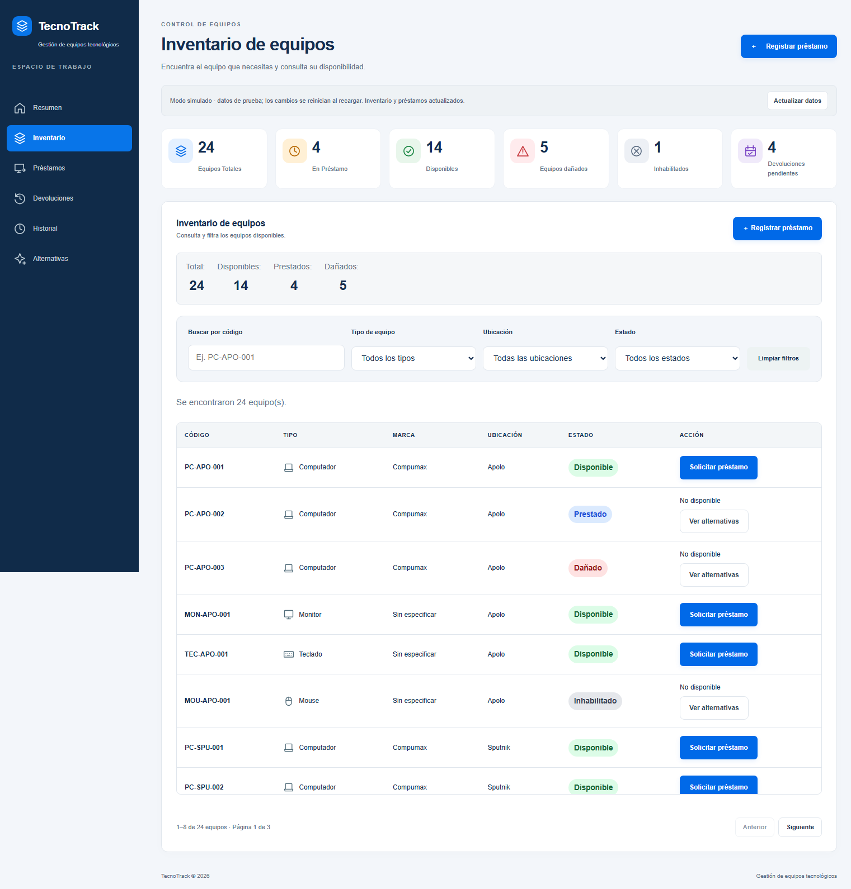
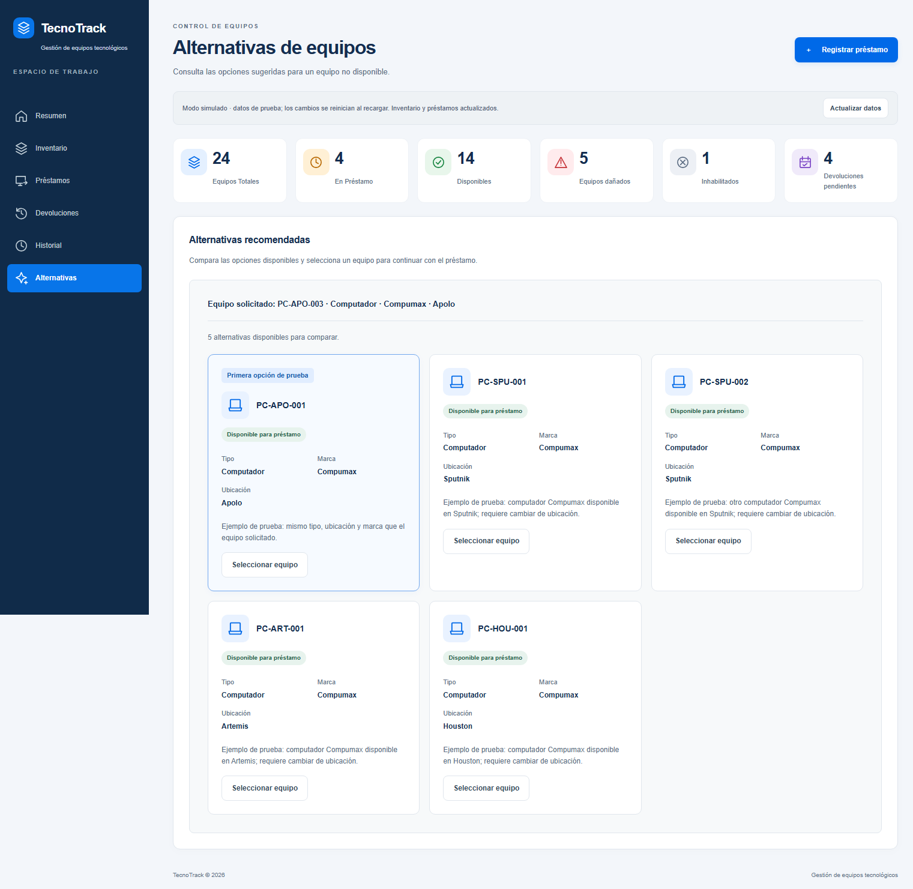

**GitHub Pages:** sin enlace público verificado. No se ha realizado un despliegue desde este trabajo.

**Repositorio:** [TecnoTrack](https://github.com/saracolmenaressb-oss/TecnoTrack_Colmenares_Sara_Rolon_Natalia).

# TecnoTrack · versión 2.0

Sistema de control de préstamos tecnológicos: consulta de inventario, préstamos, devoluciones, historial y alternativas disponibles.

**Estado:** frontend adaptado al contrato Java y probado con respuestas HTTP controladas. El backend Java no se ejecutó en este entorno por falta de herramientas disponibles en PATH. Las pruebas de contrato no sustituyen esa comprobación. La aplicación arranca en modo real; el modo simulado es una opción explícita de prueba.

## Índice

- [Problema y funcionalidades](#problema-y-funcionalidades)
- [Capturas](#capturas)
- [Tecnologías y estructura](#tecnologías-y-estructura)
- [Ejecución local](#ejecución-local)
- [Tutorial](#tutorial)
- [Arquitectura y API](#arquitectura-y-api)
- [Reglas e inteligencia artificial](#reglas-e-inteligencia-artificial)
- [Pruebas](#pruebas)
- [Equipo](#equipo)
- [Problemas conocidos](#problemas-conocidos)
- [Cumplimiento de la entrega](#cumplimiento-de-la-entrega)

## Problema y funcionalidades

Centraliza el inventario y evita registros dispersos al prestar equipos. El alcance implementado corresponde a recursos tecnológicos; no incluye aulas ni incidencias.

- Indicadores de equipos totales, disponibles, prestados, dañados, inhabilitados y préstamos pendientes.
- Búsqueda por código, filtros por tipo/ubicación/estado, SVG y paginación de ocho equipos.
- Préstamos y devoluciones con un formulario compartido, confirmación y bloqueo de envíos repetidos.
- Actualización de inventario y préstamos; avisos independientes cuando falla el historial.
- Hasta cinco alternativas válidas en el orden del servicio, sin inventar candidatos ni motivos.
- Selección que precarga el formulario sin registrar automáticamente el préstamo.
- Navegación independiente por vistas, con enlaces directos y Atrás/Adelante.
- Modo real y simulado separados: un fallo de conexión nunca activa el mock automáticamente.

## Capturas

Capturas reales del navegador en **modo simulado**. Los 24 equipos y las cinco alternativas de estas imágenes son datos de prueba, no resultados del servidor Java ni de una IA.





[Vista móvil](docs/capturas/inventario-movil-simulado.png).

## Tecnologías y estructura

HTML5, CSS3, JavaScript Vanilla, Fetch API y SVG. Backend Java 21 con HttpServer. Node.js para pruebas y servidor estático local, sin paquetes adicionales. Se conserva el script SQL y las clases JDBC del equipo; su existencia no acredita persistencia del flujo HTTP.

```text
index.html                  Entrada que redirige al frontend
fronted/index.html          Interfaz completa
fronted/css/                Estilos originales y capa visual
fronted/js/inventario.js    Inventario del equipo conectado a la API
fronted/js/app.js           Formularios y coordinación de vistas
fronted/js/api-config.js    Modo, URL base y rutas
fronted/js/api.js           Fetch, normalización y errores
fronted/js/api-mock.js      Simulación aislada en memoria
fronted/js/datos.js         Datos originales de prueba
fronted/js/navegacion.js    Rutas de las vistas
backend/TecnoTrack/         Proyecto Java
BaseDatos.sql              Script de base de datos del equipo
scripts/servir-frontend.cjs Servidor local
 tests/                    Pruebas de contrato, navegación y navegador
 docs/                     Integración y capturas
```

## Ejecución local

### Frontend

Con Node.js moderno disponible, desde la raíz:

```powershell
node scripts/servir-frontend.cjs
```

Abrir **http://127.0.0.1:5500**. Detener con Ctrl+C. También puede abrirse el index.html de la raíz, aunque HTTP es preferible para comprobar la integración.

### Backend Java

El servidor usa el puerto **8081**. Con un JDK 21 instalado, los siguientes comandos PowerShell permiten elegir la clase principal correcta sin modificar el POM. Son instrucciones basadas en el código, no una ejecución verificada en este entorno:

```powershell
Set-Location backend/TecnoTrack
New-Item -ItemType Directory -Force target/classes | Out-Null
$fuentesTecnoTrack = Get-ChildItem src/main/java/com/mycompany/tecnotrack -Recurse -Filter *.java | ForEach-Object FullName
javac --release 21 -encoding UTF-8 -d target/classes $fuentesTecnoTrack
java -cp target/classes com.mycompany.tecnotrack.Vista.TecnoTrack
```

Para Maven/NetBeans, revisar la clase principal: el POM apunta a un paquete distinto de Vista.TecnoTrack. Se conserva la configuración del equipo para su revisión.

### Configuración

En `fronted/js/api-config.js`, `modo: "real"` consulta `http://localhost:8081/api/`. Cambiar expresamente a `modo: "simulado"` para la demostración en memoria. Recargar reinicia el mock; no se mezclan sus 24 equipos con los cinco equipos iniciales Java.

Java no recibe ni persiste el documento del responsable; el formulario no lo solicita en modo real.

La conexión JDBC lee la contraseña de la variable **TECNOTRACK_DB_PASSWORD**, sin valor secreto predeterminado. Configurar esa variable en el entorno si se utiliza la conexión, y revisar URL, usuario y esquema con la responsable del backend. Si una contraseña anterior era real, debe rotarse: retirar el literal del archivo actual no lo elimina del historial. No se reescribe el historial.

## Tutorial

1. Iniciar Java para modo real o seleccionar expresamente simulación.
2. Abrir la aplicación y comprobar el aviso de modo/conexión.
3. Entrar en Inventario y utilizar búsqueda o filtros.
4. Solicitar un préstamo de un equipo disponible y prestable: se precarga el formulario.
5. Completar responsable y confirmar. Cancelar no registra nada.
6. Revisar el estado y los indicadores.
7. Entrar en Devoluciones, elegir un préstamo activo y confirmar.
8. Consultar Historial; un error de esa consulta no significa que deba repetirse una operación ya confirmada.
9. En un equipo no disponible, consultar alternativas y seleccionar una para preparar otro préstamo.

En simulación, PC-APO-003 permite probar hasta cinco alternativas existentes. En Java, PC-HOU-001 puede tener como alternativa PC-APO-001 si sigue disponible. Nunca se fuerza un mínimo de tres.

## Arquitectura y API

La navegación selecciona vistas. app.js coordina formularios e inventario.js; api.js concentra Fetch y normalización. En modo real comunica con ServidorHTTP y TecnoTrackService. En simulación utiliza api-mock.js y una copia en memoria de datos.js.

| Método | Ruta | Contrato |
| --- | --- | --- |
| GET | /api/equipos | Array de equipos |
| GET | /api/prestamos | Array de préstamos |
| POST | /api/prestamos | Envía equipoId y responsable; recibe mensaje y prestamo |
| POST | /api/devoluciones | Envía equipoId; Java admite observacion opcional |
| GET | /api/movimientos | Array de movimientos |
| GET | /api/recomendaciones?equipoId=... | Array de equipos completos |

El adaptador convierte COMPUTADOR_ESCRITORIO a Computador y DANADO a DAÑADO. Para devolver, obtiene el equipo del préstamo activo seleccionado. Los errores HTTP, JSON inválido, desconexión y timeout se presentan como texto seguro. No se reintentan escrituras automáticamente.

CORS está definido en Java con origen *, métodos GET/POST/OPTIONS y cabecera Content-Type. Los controladores actuales no implementan autenticación.

## Reglas e inteligencia artificial

Reglas implementadas en el código Java, pendientes de demostración contra el servidor ejecutándose:

1. No prestar un equipo cuyo estado no sea DISPONIBLE.
2. No prestar equipos no prestables.
3. No devolver un equipo sin préstamo activo.
4. Una devolución cierra el préstamo y actualiza el estado del equipo.
5. Las alternativas excluyen el propio equipo, otros tipos y equipos no disponibles o no prestables.

El backend tiene además una regla de observaciones que puede marcar un equipo devuelto como dañado. No se modificó esa regla.

**No hay una integración de IA acreditada.** El recomendador actual filtra por reglas; no ordena por ubicación/marca ni devuelve motivos. El frontend conserva el orden y no genera explicaciones. Mejor coincidencia permanece desactivado hasta confirmar el criterio del backend. Primera opción de prueba identifica el fixture del mock; no debe presentarse como IA.

## Pruebas

```powershell
node --test tests/api.test.cjs tests/navegacion.test.cjs
node tests/navegador.cjs
node tests/navegador.cjs --contrato
```

Últimos resultados ejecutados: ocho pruebas automatizadas aprobadas; ciclo en Edge headless en simulación con inventario, filtros, paginación, alternativas, precarga, cancelación, préstamo, devolución, historial y navegación. Presentación comprobada a 1536×1024 y 390×844.

El escenario --contrato prueba el modo real contra un **servidor HTTP de pruebas**, incluyendo fallo aislado del historial y desconexión sin fallback. **No ejecuta Java ni acredita su funcionamiento real.** Las pruebas de navegador requieren Node con Fetch/WebSocket nativos y Edge en la ruta Windows del script; no descargan herramientas.

## Equipo

El repositorio identifica a Sara Colmenares y Natalia Rolón. Confirmar nombres completos, reparto nominal y otros integrantes antes de la sustentación; no se inventa una lista de cuatro o cinco personas.

- Persona A: backend, datos, reglas y recomendaciones.
- Persona B: integración frontend–backend, adaptadores y pruebas de integración.
- Se conserva el inventario funcional de la compañera y se conecta a las instantáneas de API sin duplicar los controladores de filtros.

## Problemas conocidos

- El constructor de movimientos utilizado por Java no asigna fecha, mientras el serializador invoca getFecha().toString(). Requiere corrección del backend; la interfaz aísla el fallo, pero no lo repara.
- La clase principal del POM no coincide con el paquete de la clase existente.
- El servicio HTTP utiliza colecciones en memoria; no está acreditada su persistencia JDBC.
- Faltan motivos, prioridades e integración real de IA.
- No se ha acreditado la procedencia oficial completa del dataset ni su importación/validación.
- Falta ejecutar el ciclo contra Java y ampliar pruebas a dispositivos físicos y lectores de pantalla.

## Cumplimiento de la entrega

La guía solicita espacios, recursos e incidencias y un flujo vertical asistido por IA. TecnoTrack cubre principalmente recursos tecnológicos.

| Requisito | Estado verificable |
| --- | --- |
| Interfaz interactiva y mensajes | Implementados y probados en simulación/contrato |
| Tres validaciones de dominio | Existen en Java; falta demostración real |
| Flujo conectado con Java | Adaptador implementado; ejecución real pendiente |
| IA estratégica | Pendiente; el filtro actual no acredita IA |
| Espacios y aforo | No implementados |
| Incidencias y triaje | No implementados |
| Datos oficiales y persistencia del flujo | No acreditados |
| README y capturas | Incluidos con límites explícitos |
| Equipo de 4–5 personas y defensa | Requieren confirmación y sustentación |

No se anticipa una calificación. La demostración debe distinguir fixtures de funcionalidades reales y explicar los pendientes. El equipo debe preparar casos válidos e inválidos y dominar una modificación breve de una regla frente al jurado.
